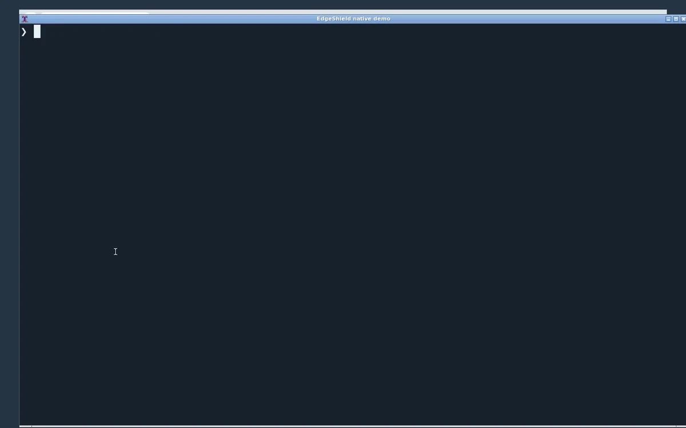

# EdgeShield · 边缘盾

自研 TypeScript SecLang 编译器和执行引擎，直接运行完整 OWASP CRS，不转换为 Shield IR。Cloudflare、Vercel、Netlify、ESA、EdgeOne 和 Node/VPS 共用同一套规则执行代码。Cloudflare 部署只需要 Worker。

真实 VM 录制：实际终端安装与启动、Geany 中的原生规则、完整 CRS 拦截和 TTL 恢复。演示将封禁 TTL 调为 5 秒；项目默认仍为 300 秒。

[](tools/demo/edgeshield-native.99f5c815d4030fec.mp4)

[播放录像](tools/demo/edgeshield-native.99f5c815d4030fec.mp4) · [GIF](tools/demo/edgeshield-native.d9684c4fe408de9a.gif)

## 目录

- `scr/`：引擎、HTTP 运行时、平台适配器、CLI、回源协议。
- `tools/`：维护工具和测试；依赖、构建、缓存、运行状态分别位于其下的 `node_modules/`、`.build/`、`.cache/`、`.state/`。
- `rules/`：完整上游源码包、同步配置、白名单和用户规则。
- `secret/`：项目凭据和回源密钥；实际文件不进入 Git 或 npm。
- `origin/{cloudflare,vercel,netlify,esa,edgeone}/<业务>/`：各平台自己的回源配置和可选业务函数。
- `respond/`：用户自定义拦截 HTML、JSON。

普通设置在根目录 `config.yml`，GitHub Actions 使用标准 `.github/` 目录。本文是唯一说明文档；许可证单独保留。

## SecLang 引擎

当前锁定 OWASP CRS v4.30.0，提交 `e03a4f6dabc7a30ebd8c52c97d28a154f590a48f`。原始 setup、所有规则及引用的数据文件一起加载：693 条 SecRule、8 条 SecAction，共 701 个执行步骤、628 条根规则。编译器核对每条源规则；缺失文件、重复 ID 和不支持的语义使严格加载失败，不完整的程序不能执行。

实现 CRS 使用的变量集合、计数、选择和排除、PCRE2、转换链、multiMatch、宏、TX、capture、chain、phase 1–5、SecDefaultAction、setvar、initcol、skip/skipAfter、ctl、异常评分及匹配日志。请求中断后仍执行 phase 5。实际解析 URL 编码、JSON、XML/XPath、multipart 和二进制请求；响应阶段检查源站返回的头与正文。

编译时为每个阶段建立保留源文件顺序的指令索引，标记在各阶段保持可见，减少运行时扫描其他阶段的开销；没有变量排除或白名单时不重复分配、检查空列表。优化不缓存规则决策、TX 状态或匹配结果。

变量宏通过同一套变量解析器读取请求、正文错误、Cookie、参数和响应数据，遵守对应阶段的可见性。TX 始终读取当前事务状态，正文处理控制发生改变时仍重新解析所需正文。请求目标与默认正文处理器只初始化一次；集合只刷新正在访问的记录，在容量不足时清理过期记录，保留其他仍有效的状态。动作合并默认策略后完整编译一次。

PCRE2 和 libinjection 仅作为匹配原语库，通过自研 WASM 适配层调用，来源、哈希及许可证在 `scr/seclang/vendor/`。规则解析、事务、状态与决策由 EdgeShield 实现，不依赖第三方 WAF 引擎，没有正则翻译、RE2 回退或按平台裁剪规则。

兼容范围以锁定的完整 CRS 和执行回归为依据。Apache 服务器配置、外部脚本等不属于已验证的规则指令范围。

## 安装和运行

```sh
npm install
npm run start:local
```

安装会把依赖放到 `tools/node_modules/`、编译到 `tools/.build/`，并仅在密钥文件不存在时创建随机凭据。已有密钥不会被覆盖。

npm 包名为 `@toewpq/edgeshield`。独立 CLI 初始化新项目后，即可使用相同的 npm 部署命令：

```sh
npm exec --package=@toewpq/edgeshield -- edgeshield init my-shield
cd my-shield
npm install
npm run deploy:local
```

发布流程在 `.github/workflows/publish.yml`。`main` 的版本文件 `scr/core/version.ts` 更新后自动触发，也可在 `main` 手动执行；package.json 和 CLI 版本必须一致。它完成引擎、完整 CRS、打包安装和 Worker 构建验证后，发布同一份经过哈希核验的 npm 归档，等待 npm 开放安装并核对归档哈希，验证 `latest` 已指向该版本。npm trusted publisher 指定 GitHub 仓库 `jsw-teams/edgeshield`、工作流 `publish.yml`，Environment 留空；Allowed actions 允许直接发布。`npm publish --tag latest` 在版本开放下载后推进标签，工作流只读核验标签，无需额外的 dist-tag 管理权限。认证使用 OIDC，无需把 npm token 放进仓库。

修改 config.yml 的 platform、域名、路由和监听地址。Node/VPS 读取选定平台的 `origin/<平台>/<业务>/config.yml`；没有单独的 Node 业务目录。默认监听回环地址，公网由自己的 TLS 入口承接。容器需要挂载自己的 secret，并按容器网络配置监听地址。

凭据均来自项目文件，不使用 Secret 环境绑定。云端私有构建会打包所需凭据，产物不能作为公开静态资源或 npm 包发布。Node 支持规则、白名单和自定义回应热更新；业务代码或监听地址修改后重启。

## 回源

每条路由必须通过 `business` 选择业务名。例如同一 EdgeOne 部署可以使用 `origin/edgeone/shop/index.js` 处理商城函数，`origin/edgeone/orders/config.yml` 回源订单 VPS，`origin/edgeone/search/config.yml` 回源搜索服务的负载均衡 CNAME。各业务配置独立，不能通过请求参数更换源站；同一引擎检查所有业务的请求和响应。构建只包含当前平台被路由引用的业务。

```yaml
routes:
  - path: /shop
    business: shop
    methods: [GET]
    authenticated: false
  - path: /orders
    business: orders
    methods: [GET, POST]
    authenticated: false
    body: text
  - path: /search
    business: search
    methods: [GET]
    authenticated: false
```

在各自的 `origin/<平台>/<业务>/config.yml` 选择模式。普通代理支持 VPS IPv4/IPv6、域名和负载均衡 CNAME：

```yaml
platform: cloudflare
mode: proxy
url: https://lb.business.example
```

也可填写 `https://192.0.2.10` 或 `https://[2001:db8::1]:8443`。使用正常 HTTPS 证书校验，不关闭验证。配置固定源站，拒绝跟随重定向；清理转发头，加入来自 secret 的 `x-shield-origin-auth`。外部业务应验证该令牌，避免绕过防火墙直连源站。请求和源站响应均经过同一个 SecLang 引擎。

平台内业务函数使用 `mode: function`，由 `origin/<平台>/<业务>/index.js` 默认导出的 `fetch(request)` 处理。默认业务只有健康检查，其他路径返回 404。构建器拒绝跨平台引用其他业务文件；代理模式不会加载这些函数。

加密中继可部署在 VPS 或支持 WebCrypto 的云函数：

```sh
npm run relay:init
node tools/.build/scr/cli/main.js serve-relay secret/relay-server.yml
```

密钥在 `secret/relay/`，服务器配置由 `secret/relay-server.example.yml` 初始化。云端只读取公钥和认证密钥，服务器私钥留在回源端：

```yaml
platform: cloudflare
mode: relay
endpoint: https://relay.example/_edgeshield/relay
publicKeyFile: ../../../secret/relay/public.jwk
authenticationKeyFile: ../../../secret/relay/authentication.key
```

协议使用 ECDH、HKDF、双向 AES-GCM、HMAC、请求绑定和时间窗口，VPS 用 SQLite 持久化防重放。保留二进制正文和多个 Set-Cookie，并限制实际字节数和读取时间。Node 中继默认监听回环地址，需放在 HTTPS 入口后；云函数可通过 `/relay` 的 `createRelayServer` 接入自己的原子性持久化 ReplayStore。

## 按平台构建、启动和部署

```sh
npm run build:cloudflare
npm run start:cloudflare
npm run deploy:cloudflare
# 平台名同样支持 vercel、netlify、esa、edgeone、local。
# 先构建并查看部署命令，不执行云端操作：
node tools/.build/scr/cli/main.js deploy vercel config.yml --plan
```

独立安装的 npm CLI 使用 `edgeshield build <平台> config.yml`、`edgeshield start <平台> config.yml`、`edgeshield deploy <平台> config.yml`。本地 build 严格验证完整规则与配置，start/deploy 启动同一个 Node 服务。

云平台命令先构建当前平台，再调用项目已安装的官方 CLI：Cloudflare 为 wrangler，Vercel 为 vercel，Netlify 为 netlify-cli，ESA 为 esa-cli，EdgeOne 为 edgeone。先在自己的部署项目安装对应工具并完成登录及项目关联；启动、部署使用工具自身的权限，不增加引擎环境变量。

私有产物在部署项目的 `tools/.build/<平台>/`，其中 `deploy/` 只包含该平台需要的部署文件。Vercel 的私有代码放在 api/index.mjs，Netlify 的静态 public 目录保持为空。不要把整个私有构建目录发布为静态资源。Cloudflare 使用静态 WASM；其他入口加载相同 WASM 字节。Vercel 使用 Node Functions，Netlify 使用 Fetch 函数，ESA 使用 Fetch 入口，EdgeOne 使用 onRequest 入口。平台自己的载荷、CPU 和内存限制仍然适用。

CRS 的 REQUEST_PROTOCOL、REQUEST_LINE 和 REMOTE_ADDR 需要真实传输信息。Cloudflare 读取平台信息，Node 读取连接元数据。其他 Fetch 入口要求由可信入口用 `secret/credentials.yml` 的 ingressKey 签名传递原始协议/IP；缺失或伪造返回 503，不会编造 HTTP/1.1 或跳过相关规则。

`@toewpq/edgeshield/ingress` 的 `createIngressForwarder(destination, ingressKey)` 可接入现有可信 Node/Worker 入口，调用时传入实际 httpProtocol、verifiedClientIp，以及可用的 rawTarget。签名绑定方法、目标、原始 URL、元数据和时间戳；后端恢复请求再执行完整 CRS。客户端自报的转发头不能作为可信元数据。

## 请求次数与缓存成本

静态 HTML、指纹 CSS/JS 和图片应交给平台静态资源服务，动态业务才进入函数。Cloudflare 的 assets 默认先匹配静态文件，`run_worker_first` 只列需要引擎处理的动态路径；不要设为全站 `true`。资产服务返回的文件不会执行 SecLang，不应存放需鉴权或请求检查的业务数据。其他平台应使用各自静态托管目录，私有构建目录不能公开。

动态业务可以显式启用浏览器缓存，适用于不因用户身份变化的公开内容：

```yaml
routes:
  - path: /catalog
    business: shop
    methods: [GET, HEAD]
    authenticated: false
    browserCache:
      maxAgeSeconds: 120
```

源站还必须明确返回 `Cache-Control: public, max-age=N`；引擎取源站与配置中较短的期限，输出 `private, max-age=N, must-revalidate`。浏览器在有效期内直接复用正文，从而减少网络请求和函数调用。保留 Date、Age、ETag 与 Vary，并加入 Cookie/Authorization 的 Vary；认证、Cookie、Set-Cookie、强制刷新、错误回应、私有源站回应及 WebSocket 均不启用。默认仍为 no-store；TTL 可配置为 1–86400 秒。内容更新在 TTL 到期或客户端刷新后可见，应按业务的新鲜度要求设置。

每个实际到达引擎的请求仍执行完整规则，缓存不复用防火墙决策。引擎没有服务端响应缓存，也不会用 304 冒充免调用。Cloudflare 的 `caches.default` 命中仍先执行 Worker；新版 Workers Cache 能减少执行 CPU，但其缓存命中仍按 Worker 请求计费，而且会绕开该次规则执行，因此本项目不自动启用。参见 [静态资源计费](https://developers.cloudflare.com/workers/static-assets/billing-and-limitations/) 和 [Workers 请求计费](https://developers.cloudflare.com/workers/platform/pricing/)。实时流、写入和鉴权请求保持动态执行；调用次数不能仅靠降低 CPU 或延长服务端缓存变成零。

## 原生规则与临时防护

规则入口按 setupRulesFile、secLangFile、localRulesFile 的顺序加载，分别用于前置策略、完整上游规则和用户后置规则。缺失 Include、数据文件、重复 ID 或不支持的语义都会阻止加载；引擎不写规则转换器，不将其他规则语言转换为 SecLang 或旧 IR。

默认 rules/setup.conf 已启用实际行为防护：同一 IP 瞬时超过 120 次请求（每秒恢复 20 次额度），或 60 秒内出现 3 次达到实际 CRS 拦截阈值的攻击，临时拒绝 300 秒。封禁期间的访问不会续期，到期恢复；普通低频访问不累计成永久封禁。阈值、窗口、TTL 和用户白名单都可修改，更新工具不会覆盖用户策略。

rules/emergency.conf 包含直接执行的原生 SecLang 虚拟补丁，目前针对 CVE-2025-29927 拒绝外部携带的 x-middleware-subrequest 头，包括空值；依据 [Next.js 官方应急措施](https://github.com/vercel/next.js/security/advisories/GHSA-f82v-jwr5-mffw)。该文件由维护者更新并运行回归测试，不把 CVE 目录条目自动宣称为已防护。重复命中此补丁也参与临时封禁。

原生 SecLang 规则可直接引用原始数据文件，无需生成规则代码。例如下面的规则会实际阻止列表中 IP/CIDR 发起的请求：

```apache
# threat-networks.txt 必须是用户选定、校验过的 IP/CIDR 列表；此处不默认启用任何第三方黑名单。
SecRule REMOTE_ADDR "@ipMatchFromFile threat-networks.txt" "id:1000400,phase:1,deny,status:403,log"
SecRule ARGS "@pmFromFile threat-phrases.txt" "id:1000401,phase:2,deny,status:403,log"
```

文件路径相对规则源文件解析。支持多个文件、IPv4/IPv6 与 CIDR，保留短语匹配和 capture 语义；无效网络或缺失文件使严格编译失败。文件可以使用 .data、.txt、.ipset、.list 扩展名。HTTP 参数中的域名短语匹配不等于 DNS 或出站流量防火墙。

[OWASP CRS](https://coreruleset.org/) 是当前完整验证的原生规则源；[Atomicorp](https://docs.atomicorp.com/gotrootModsec/) 也发布原生 SecLang 规则，但需要相应授权和私有规则文件，尚未在本项目验证整套兼容性，不会复制进公有仓库。多个原生来源通过 rules/seclang-upstreams.json 配置，直接加载原文；发现缺失语义时补齐引擎并测试，不能删规则制造通过率。

纯 Worker 的集合属于当前引擎实例，不能提供跨实例、跨区域或重启后的全局计数。到期在访问时核验，不依赖实例存活到某个定时器；不会在平台上遗留需要额外清理的远程封禁规则。未知载荷的突发行为同样执行上述封禁，不依赖载荷恰好命中某个 CVE 签名。

## 白名单与拦截回应

`rules/allowlist.yml` 支持全局、规则 ID、路径/前缀、方法、身份、IP/CIDR 和可选过期时间：

```yaml
- id: trusted-search
  skip: [rules]
  ruleIds: ['942100']
  path: /api
  cidrs: [192.0.2.0/24]
```

省略 ruleIds 或填写 `['*']` 可豁免全部规则，也支持 sec- 前缀。默认没有豁免；白名单不绕过路由、认证、HTTP 边界或字节上限。

在 `respond/403.html` 放完整 HTML，例如 EdgePress 构建页面，403.json 定义 JSON 回应；其他 4xx/5xx 使用相应文件名。HTML 不插入请求内容，CSP 在 config.yml 中配置，保留拦截状态与 HEAD 语义。

## 上传与验证

配置读取的 8 MB 上限与 HTTP 上传无关。limits.maxBodyBytes 控制实际上传字节，项目默认 8 MiB，最高可配置 16 MiB，不相信 Content-Length。完整 CRS 下验证大于 2 MiB 的 multipart 文件保真回源，普通恶意字段仍被检查。

单个转换值上限 2 MiB；PCRE2 的步数、深度、内存以及状态集合有资源边界。超限中止并拒绝，不能当作不匹配放行。压缩请求正文及原始 gRPC 帧未提供入口。显式 websocket 路由检查真实握手及 101 响应头，保持平台原生二进制消息；升级后的不透明消息不交给 SecLang 检查。

```sh
npm run test:crs
node tools/sync-native-seclang.mjs --latest
# npm CLI 也提供相同的严格同步器
edgeshield sync --registry rules/seclang-upstreams.json --output rules/seclang-bundle.json
npm run check
npm run cloudflare:dry-run
npm run audit
```

rules/seclang-upstreams.json 支持多个来源。同步核对不可变 Git blob 和 SHA-256，严格加载全部源码，核对每条规则的执行指令，再运行正常/攻击/响应及性能回归，全部通过后原子替换源码包。GitHub Actions 每 6 小时验证并更新 main，用户规则、白名单和凭据不参与同步。

CI 覆盖 Linux/Windows、Node 22/24；包括完整 CRS PL1–4、五平台构建入口、真实 workerd、capture/chain/TX/ctl、误杀、SQLi/XSS/LFI/RCE、官方 WebShell 响应签名、上传、回源、防重放、TTL 指令、npm 独立安装和性能。没有用忽略规则或模拟匹配代替执行。本地验证不等于已在五家云账户部署。
