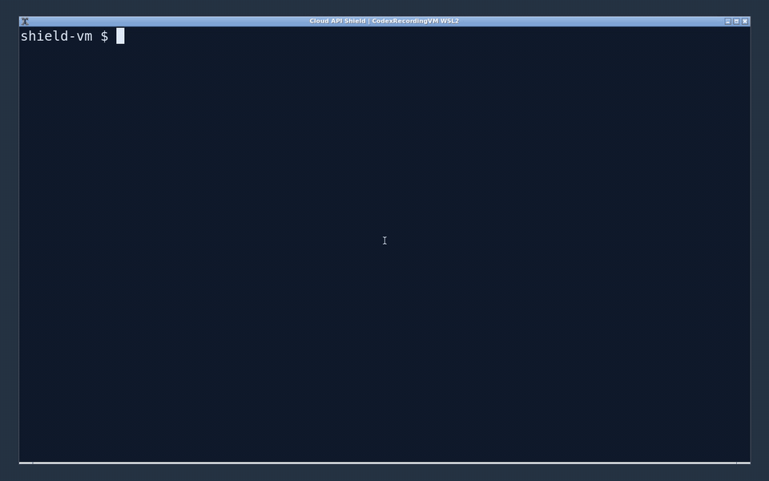
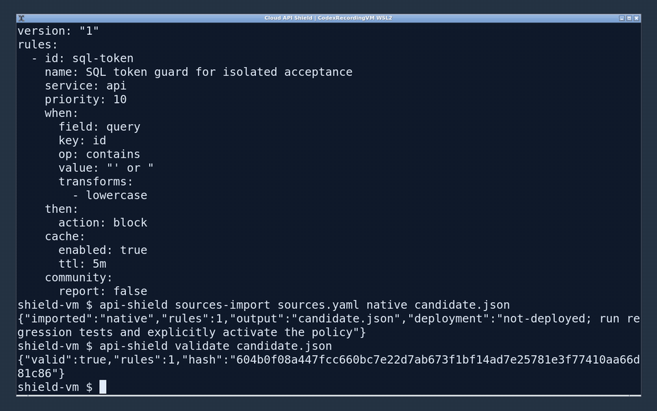
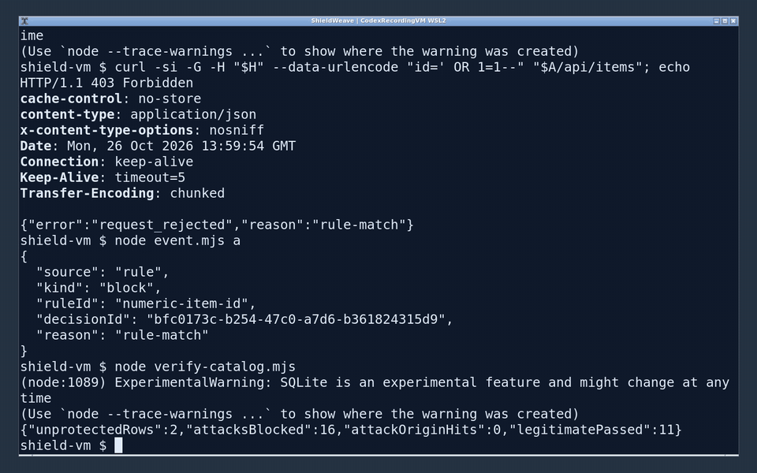

# Cloud API Shield

[Configure cloud/VPS origins and rule sources](docs/SOURCE-CONFIG.md)

[简体中文](README.zh-CN.md) · Apache-2.0 · TypeScript / ESM · Node.js 22.13+ (24 recommended)

Versioning: **YYYY.M.N** — `2026.10.1` means the first release in October 2026. Increment N within a month and reset it in the next month; Git tags use `v2026.10.1`. Published versions are immutable.

## Actual VM recordings

The following GIFs capture the existing CodexRecordingVM WSL2 guest's real Openbox desktop and xterm. Commands execute installed packages against an isolated HTTPS origin with a locally trusted certificate; they do not deploy cloud rules or use production data. The SQL-like payload tests the displayed authored rule, not comprehensive SQL injection or CVE coverage.

Configuration, pinned source import and Schema validation:



HTTP 200/403, first rule hit, L1, a second process L2, origin authentication and decision revocation:



Independent SecLang subset import, explicit activation/rollback, changed-source and lossy-conversion refusal:



[Full VM recording and machine-checked evidence](https://github.com/jsw-teams/api-shield/releases/tag/v2026.10.2). No custom HTML console or rendered terminal is used. Full CRS and native gRPC remain unsupported. To reproduce with an already provisioned WSL2 recording guest containing Xvfb/Openbox/xterm/xdotool/FFmpeg/Node (the recorder does not install or enable WSL):

```sh
npm ci
npm run build
npm pack --pack-destination artifacts
# From api-shield-convert/: npm ci && npm pack --pack-destination ../artifacts
npm run demo:record
```

The recorder asserts 29 real shell commands and captures X11 pixels with FFmpeg. Only its own acceptance processes are stopped. If it started the guest, it terminates that dedicated guest afterwards; do not point it at a guest running your other work.

A portable API security runtime with strict HTTP handling, versioned rules, revocable security
decisions, an authenticated control API, and offline adaptive security tools. The engine uses Web
APIs; Node-specific persistence and cloud SDKs live outside its dependency graph.

**Status: an implemented, tested first release, not a production certification.** Phase 1 is runnable
end to end. Later phases contain working components with the limitations below. No cloud resources
have been changed or verified against a live account. See [delivery status](docs/STATUS.md),
[threat model](docs/THREAT-MODEL.md), and [validation evidence](docs/VALIDATION.md).

| Capability | Implemented and tested | Boundary |
| --- | --- | --- |
| Runtime | YAML/JSON + static JSON Schema validation; AND/OR/NOT; fields, RE2 regex, ordered transforms, scoring, local rate windows; safe proxy | Exact configured routes; compressed bodies, multipart, response-phase rules and interactive challenges rejected; WebSocket needs its explicit adapter |
| Backend standard | [Unified contract](BACKEND-STANDARD.md), origin-key rotation, strict JSON middleware, required auth/authorization/CSRF callbacks, safe output and redacted events; CLI configuration check | Application adoption and production ingress evidence still required; JSON middleware is not a universal wrapper for HTML/media |
| Protocols | [Media streaming](PROTOCOLS.md), experimental WebSocket handshake IR/cache + bounded message relay, binary gRPC-Web envelope checking | Native gRPC adapter unsupported; protobuf authorization and established-socket revocation require further integration |
| Decisions | Bounded LRU/TTL; tenant isolation; epochs/CAS; shared reference store; authenticated HTTP store; SQLite WAL authority and audit | Memory store is process-local. SQLite is a single-node authority; HTTP reads are a working cross-process path, not a Redis/KV implementation |
| Control | Tenant-bound runtime/admin credentials; versioned policies; activation/rollback; decision revocation | CLI listeners bind loopback; deploy behind TLS/private ingress. Runtime policy changes require explicit engine reload/deployment |
| Five clouds | Browser-target runtime bundles and sandbox block/proxy checks for Cloudflare, Netlify, Vercel, ESA and EdgeOne | Sandbox verification is not provider deployment verification |
| Native firewalls | Real Cloudflare REST, ESA SDK, Vercel REST + draft activation, EdgeOne TC3 REST lifecycle code; plan approval, drift/readback/revoke/retry tests | Conservative method/canonical IPv4 compiler subset. Path/body/header/query rules stay runtime-only. Netlify native management unsupported. Quotas are explicit operator inputs |
| CVE | Real Go OSV fixture; OSV query and dedup; SEMVER evaluation; CycloneDX/SPDX/npm lock import; CVE5, KEV, EPSS ingestion; tested, preauthorized feature isolation | Configuration exposure, arbitrary ecosystem versions, vendor patch verification, precise automatic virtual patches and durable response orchestration remain planned |
| Learning | Trusted-source API discovery, EWMA/type baselines, poisoning quotas, freeze/rollback, anomaly candidates, shadow/canary evaluation gates | Experimental library/offline CLI. No automatic capture, training, publication or online model installation |
| Rule ecosystem | Separate [api-shield-convert](api-shield-convert/README.md) package; strict import provenance/license/hash gate | Small SecLang subset; CrowdSec extraction is partial; full CRS/native-engine integration planned |
| Community | Opt-in gates; Ed25519 reports/feeds; independent-organization quorum; warnings, TTL, anti-replay, revocation | Experimental local service logic. No public service, trust onboarding, persistent feed sequence or legal process supplied; all sharing off by default |

Cloudflare has a [validation Worker manifest](deploy/cloudflare/README.md), a real local workerd
test covering 101 upgrades, origin service bindings, L1/L2 and revoke, and a Wrangler dry-run.
No production domain, route, existing Worker or live firewall has been changed. This open-source
project is independent of Cloudflare's commercial API Shield product.

## Run locally

```sh
npm ci
npm run check
npm run check:edge
npm run test:converter
npm run dev
```

The local system binds only `127.0.0.1`: Shield `8787`, a token-protected API `8788`, control `8790`.
It uses a real SQLite file `shield-local.db`. Environment secrets are optional for this isolated
local system; random fallback secrets are never printed. Set them explicitly for control operations.

```sh
curl "http://127.0.0.1:8787/api/echo?q=hello"
curl "http://127.0.0.1:8787/api/echo?q=shield-attack-test"
curl "http://127.0.0.1:8787/api/echo?q=shield-attack-test"
curl "http://127.0.0.1:8788/api/echo"
```

Expected: 200; 403 event source `rule`; 403 source `l1`; direct-origin 403. The marker rule is
explicitly an example operator rule, **not** a SQLi/RCE detector. Tests verify actual field matching,
body parsing, regex safety, proxy isolation, cross-instance cache behavior and revocation races.

## Rule and operations tools

```sh
npm run build
node dist/packages/cli/main.js validate examples/rules.yaml
node dist/packages/cli/main.js backend-check examples/backend-policy.yaml
node dist/packages/cli/main.js explain examples/rules.yaml
node dist/packages/cli/main.js simulate examples/rules.yaml examples/samples.json
node dist/packages/cli/main.js compatibility examples/rules.yaml
node dist/packages/cli/main.js assess examples/inventory.json tests/fixtures/GO-2023-2102.json
node dist/packages/cli/main.js --help
npm run benchmark
npm run test:workerd
npm run cloudflare:dry-run
```

Read [RULES](RULES.md), [DEPLOYMENT](DEPLOYMENT.md), [CLOUD-ADAPTERS](CLOUD-ADAPTERS.md),
[CVE-AUTOMATION](CVE-AUTOMATION.md), [THREAT-INTELLIGENCE](THREAT-INTELLIGENCE.md),
[ARCHITECTURE](ARCHITECTURE.md), and [CONTRIBUTING](CONTRIBUTING.md).

No telemetry or third-party rules are bundled. Network operations occur only through an explicitly
started proxy/control client, an explicitly invoked intelligence fetch, or configured cloud
management methods. The control plane stores decision hashes and minimal audit metadata, not raw
requests. WAF mitigation never substitutes for upstream upgrades or verified protocol termination.

## Security and license

[SECURITY.md](SECURITY.md) describes reporting and deployment boundaries. Apache-2.0 was chosen
for permissive cross-cloud use with an explicit patent grant. Third-party dependencies retain their
own licenses; external rule import requires explicit license approval. Source digests are computed
internally and converter reports must match the actual bytes; configuration has no checksum setting.
