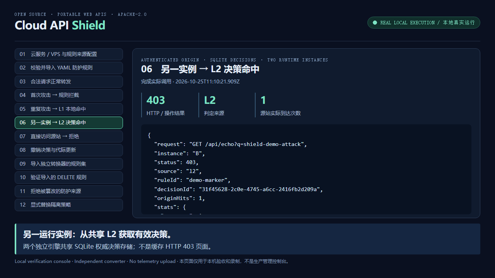

# Reproducible feature video / 可复现功能视频

The Chinese-captioned recording shows actual local execution, not generated scenes or fabricated
responses. It uses two independent Shield engines, real TCP listeners and an authenticated origin,
plus a shared SQLite decision authority. The console is a local acceptance/recording tool, not a
production administration interface. No private operator configurations appear in the video.

[观看 / 下载 MP4](https://github.com/jsw-teams/api-shield/releases/download/v0.1.2/cloud-api-shield-demo.zh-CN.mp4)
 · [机器断言证据](https://github.com/jsw-teams/api-shield/releases/download/v0.1.2/demo-evidence.json)



演示内容：配置云端/VPS 与规则来源；YAML/Schema/版本/哈希/许可证校验；正常请求；首次规则
拦截；L1 命中；另一实例 L2 命中；源站令牌隔离；撤销与重新匹配；独立转换器导入 SecLang
子集并验证拦截；篡改来源拒绝；显式策略替换。

The attack query is an authored test marker, not a claim to detect a particular real CVE. Cloud/VPS
inventory entries are validated examples; request traffic in the recording stays on loopback.
Full CRS conversion and native gRPC are unsupported. Cloud deployments and provider credentials
are not exercised. Revoking a cached decision does not disable the rule that produced it.
There is no voiceover; on-screen Chinese captions explain each actual result.

## Record again

```sh
npm ci
npx playwright install chromium
# FFmpeg with libx264 must be on PATH, or set FFMPEG_PATH to its executable.
npm run demo:record
```

Outputs: `artifacts/demo/cloud-api-shield-demo.zh-CN.mp4`, `evidence.json`, numbered screenshots
and the original WebM. The recorder asserts every result and aborts on a mismatch. `DEMO_FAST=1`
shortens only reading pauses for smoke verification; it does not change engine responses.
Evidence records the source commit and whether the checkout had uncommitted changes.

```sh
# Interactive console, binds only to a random 127.0.0.1 port; Ctrl+C stops all its listeners.
npm run demo:serve
```

录制页面使用随机端口和一次性 CSRF token，拒绝跨站操作和错误 Host；浏览器录制时禁止外部
网络。录像结束会关闭它创建的浏览器、服务、SQLite 和临时目录。不要把此验收控制台公开部署。

Recording follows [Playwright's video lifecycle](https://playwright.dev/docs/videos): closing the
browser context flushes the file. FFmpeg converts the actual frames to H.264 MP4 with faststart;
it does not synthesize security results. Reproduce configuration imports with
[SOURCE-CONFIG.md](SOURCE-CONFIG.md).
