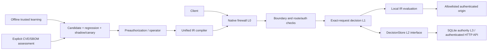

# Architecture / 架构

The six logical responsibilities remain separate. Only implemented modules are present; future
backend services are tracked in [docs/STATUS.md](../STATUS.md).

| Responsibility | Code | Execution |
| --- | --- | --- |
| Runtime | `packages/runtime`, `core`, `http-boundary`, `rule-ir` | Web API engine; offline-compiled validator; no Node builtins |
| Control plane | `packages/control-plane` | Node + SQLite WAL; authenticated API and immutable policy versions |
| Adaptive learning | `packages/learning` | Offline trusted batches; explainable snapshots and rollout gates |
| Vulnerability intelligence | `packages/vulnerability`, `integrations/sbom` | Explicit feed fetch/import, version/exposure assessment, verified proposals |
| Cloud enforcement | `packages/cloud-compiler`, `adapters/*` | Background operator process, never request-path management calls |
| Community intelligence | `integrations/threat-intelligence` | Optional signed local hub/subscriber logic, disabled by default |

Requests are checked for route/identity before consulting a cached block. Request bodies are fully
bounded and inspected before the first upstream byte is sent; responses stream with a deadline and
size bound. Events exclude headers, URLs, identities, IPs and bodies by default. Cache fingerprints
are hashes, not anonymization claims; authorities must still be access-controlled.

The L2 contract is linearizable per tenant. `MemoryDecisionStore` is a test/reference implementation;
`HttpDecisionStore` is a real cross-process path backed by an authority. KV eventual consistency
cannot safely implement epoch/CAS by itself. Redis scripts, Workers Durable Objects and other
production replication providers remain planned. A control failure discards cached decisions and
evaluates pinned local rules, so policy enforcement can continue without a live controller.

Default epoch polling is 1000ms; 0 requires a check every request. A request already admitted may
finish using its start-of-request epoch. A revoke invalidates the tenant's entire cached generation,
including stale in-flight writes. This deliberately favors revocation correctness over hit rate.
Existing local rules can still issue a fresh block after re-evaluation. Rule rollback is a separate
audited operation. No client-controlled tenant/header selects the authority tenant.

中文：按在线执行、控制、学习、漏洞、云联动和社区六个职责分块。复杂计算不进入请求路径。
源站令牌、身份和路径边界不受学习器控制。当前没有自动化的“学习即上线”；候选规则必须
经过独立样本、Shadow、Canary 及授权门控。详细决策见 [ADR](../ADR.md)。
